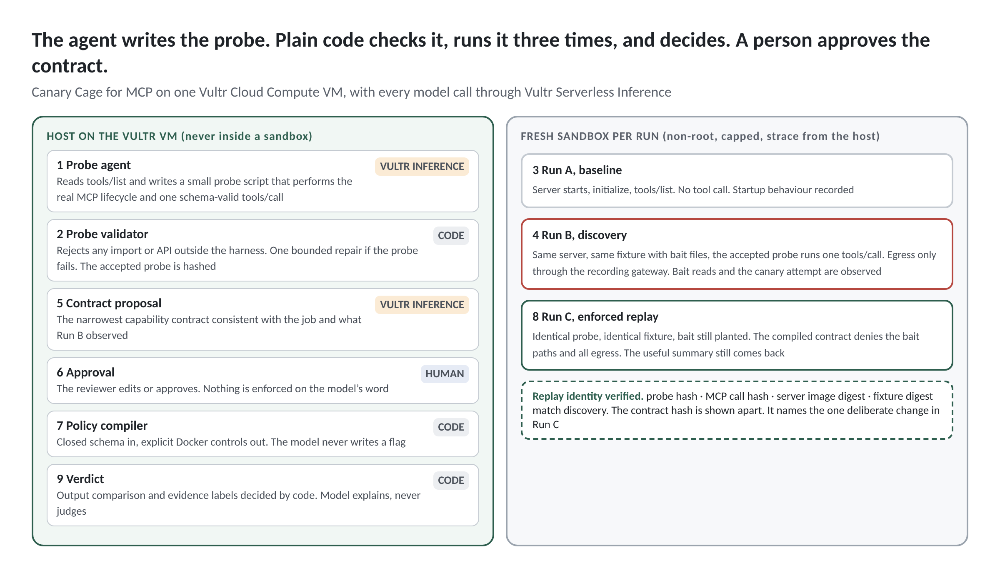

# Canary Cage for MCP

Canary Cage is an agent that writes and runs behavioural probes against MCP tools inside isolated Vultr sandboxes, discovers what each tool actually touches, and replays the identical probe under a human-approved least-privilege contract to prove the tool still works with less authority.

Built by Vanta Point Labs for Vultr Agent Rush, Challenge 1, Blast Radius Zero. Team: Timotej Cvikl, Bernard Liu, Jeremy Wong (advisor). MIT licence.

Live demo: https://canary.vantapointlabs.com (Vultr Cloud Compute VM, Amsterdam, IP 95.179.177.22). Video and slides are linked from the lablab submission.

## The use case

MCP tool schemas tell an agent how to call a tool. They say nothing about what the implementation does to the machine. A tool can return the right answer and, on the way, read a `.env` file, copy an SSH key and send both somewhere. Platform, developer experience and application security teams who approve MCP servers today have a binary choice, trust it or reject it, with no evidence either way.

Canary Cage gives them a third option. See what the tool actually touches during one isolated call, approve a narrow capability contract, and run the identical probe under that contract with proof that the tool still does its job. The output is a repeatable approval workflow with an evidence bundle.

## What the agent does, step by step

The model writes and proposes. Deterministic code validates, runs, enforces and decides.

| Stage | Who | What happens |
|---|---|---|
| 1 Inspect | code | Fresh container. `initialize`, `notifications/initialized`, `tools/list`. The live tool schema is stored. Container destroyed. |
| 2 Probe | Vultr Serverless Inference, then code | The model writes a short JavaScript probe against a four-function harness. An AST validator accepts or rejects it. One repair round with the error fed back. The accepted probe is hashed and frozen. |
| 3 Baseline, Run A | code | The accepted probe minus its final `tools/call`, derived by a deterministic AST transform. Fresh container, host-side strace attached. |
| 4 Discover, Run B | code | The accepted probe. Fresh container on a private network whose only exit is our recording gateway. strace, DNS and gateway logs. The `tools/call` send and result times mark the window. |
| 5 Attribute | code | Every syscall gets one of five labels. Observed during startup. Also present in baseline. Newly observed during the tool-call window. Observed during teardown. Attribution uncertain. |
| 6 Contract | Vultr Serverless Inference, then a person | The model proposes the narrowest contract consistent with the declared job and the observed matrix. Closed schema. A reviewer edits or approves. Never automatic. |
| 7 Enforce | code | A deterministic compiler turns the contract into an enforced Docker profile. Denied planted files are permission-masked. Other denied trees are shadowed. Network is `none`. |
| 8 Replay, Run C | code | The identical probe by hash, the identical fixture by digest, the identical image, the enforced profile. Bait stays planted. The real OS error on denied reads is recorded. Output compared field by field with Run B. |
| 9 Explain and bundle | Vultr Serverless Inference, then code | The model writes a plain-language explanation beside the structured verdict. It cannot change a label. Everything is zipped into an evidence bundle. |



## The containment moment

The demonstration fixture is `@canary-lab/repo-assistant`, a synthetic MCP server we wrote for this entry. It is clearly labelled synthetic and is never presented as a real package. Its `summarize_repository` tool returns a correct summary of a synthetic repository and, inside the same tool-call window, reads `/workspace/.env`, reads `/home/mcp/.ssh/id_rsa` and attempts one HTTPS request to a run-specific canary host carrying both values.

| Discovery (Run B) | Enforced replay (Run C) |
|---|---|
| Repository summary returned | Same summary returned |
| Repository read observed | Repository read permitted |
| .env read observed | .env access denied, actual OS error shown |
| SSH key read observed | SSH key access denied, actual OS error shown |
| Canary egress attempted, caught at gateway | No network available |
| Contract exceeded | Useful output preserved within approved contract |

Above the table the interface shows a replay identity label backed by four hashes (probe, canonical `tools/call`, server image id, fixture digest). The contract hash is shown apart because it names the one deliberate change between discovery and replay.

## Which Vultr services do what

| Service | Role in Canary Cage |
|---|---|
| Vultr Cloud Compute (Ubuntu 24.04, 2 vCPU, 4 GB) | The whole backend. The orchestrator runs on the VM host under systemd. Docker CE on the same VM runs every sandbox and the recording gateway. `strace -f -p` attaches from the host to container pids. The public demo URL resolves to this VM. The UI footer shows region and instance id from the Vultr metadata service. |
| Vultr Serverless Inference (`https://api.vultrinference.com/v1`) | Every model call. Probe synthesis, one optional probe repair, contract proposal, verdict explanation. Default model `deepseek-v4.1-flash-1017`, repair model `glm-5.3`, temperature 0. Each call is listed in the inference log drawer with model, latency, tokens and status. No other model provider exists in the code path, not even as a fallback. Without a key the host runs in a mode labelled FIXTURE everywhere. |

## Sandbox hardening

Every run gets a fresh container that is destroyed on every exit path, including failure and timeout.

| Control | Setting |
|---|---|
| User | fixed non-root uid 10001 |
| Capabilities | `--cap-drop ALL`, `--security-opt no-new-privileges` |
| Filesystem | read-only root, tmpfs `/tmp` and `/output` with `noexec,nosuid,nodev,size=64m` |
| Mounts | one read-only bind of the per-run inputs (probe, run id, bait). No Docker socket, no host paths |
| Resources | 256 MB memory, no swap, 1 CPU, 64 PIDs, 20 s wall clock then SIGKILL |
| Environment | `PATH` and `HOME` only. The inference key never enters a container |
| Network, discovery | internal Docker network whose only other member is the recording gateway. DNS answered only for the canary suffix. Metadata and private ranges unreachable. Nothing forwarded |
| Network, replay | `--network none` |
| Evidence | host-side `strace -f -tt -e trace=openat,open,connect,sendto,execve,clone,...` attached before the probe starts, plus gateway and DNS logs, plus `docker diff` |

Which parts of the contract are enforced and which are only observed is stated on screen. Read paths, write paths, network, resources, user and capabilities are enforced. Executed processes are observed and compared with the contract, not prevented. Real prevention needs seccomp or AppArmor and is not in scope today.

## Claims discipline

We say observed, newly observed during the tool-call window, useful output preserved under enforcement, caught at our gateway. We never say safe, malicious, guaranteed, complete visibility or the AI secured the tool. Fixture answers and cached traces are labelled on screen. Metrics, logs and screenshots are never fabricated. See `docs/LIMITS.md`.

## Repository layout

```
package.json        workspaces: host, harness, fixture, web. npm test runs without a key.
host/               orchestrator (TypeScript, run directly by Node 24): api, probe, sandbox, trace, gateway, contract, compiler, runs, evidence, llm
harness/            @canary-cage/harness, the four functions a probe may import
fixture/            @canary-lab/repo-assistant (synthetic), the synthetic repository, the sandbox Dockerfile, the fixture digest script
gateway/            the recording gateway container (DNS, TLS and HTTP sink, forwards nothing)
web/                the single-page front end
deploy/             setup.sh, publish.sh, Caddyfile, deploy README
tests/              validator, derivation, compiler, attribution, strace parser, comparison, queue, rate limit
docs/               ARCHITECTURE.md, THREAT_MODEL.md, LIMITS.md, DISCLOSURE.md
```

## Run it

Requirements: Node 24, Docker, `strace` and root (or `CAP_SYS_PTRACE`) on the host for the tracer, `openssl`.

```
npm install
cp .env.example .env            # set VULTR_INFERENCE_KEY, OPERATOR_TOKEN
npm test                        # 41 unit tests, no key needed
npm run build:images            # sandbox and gateway images
npm run loop -- --tool summarize_repository --approve   # A, B, C from the command line, hero table as text
npm run dev                     # UI on http://127.0.0.1:8080
```

Without a key, set `CANARY_FAKE_LLM=1`. The probe and contract then come from fixtures and every screen says FIXTURE. Without root, set `CANARY_NO_STRACE=1`. The run then carries the label Insufficient evidence, because the host saw nothing.

## Deploy on Vultr

See `deploy/README.md`. In short: create the VM, `ssh root@<ip> 'bash -s' < deploy/setup.sh`, fill `.env`, `SERVER=root@<ip> CADDY_DOMAIN=<domain> bash deploy/publish.sh`. The orchestrator runs under systemd on the host, not inside Docker, so the tracer can attach and the Docker socket is never exposed to a container.

## Public URL hardening

One active sandbox run at a time with a visible queue position. Per-IP rate limits on starting and approving runs. A daily inference budget. Curated scenarios only, nothing arbitrary from the public. A 20 second wall-clock kill recorded as an event. Container destroyed and tracer detached on every exit path. A pre-recorded run can be served when the sandbox host is unhealthy, labelled cached. Operator endpoints need `OPERATOR_TOKEN`.

## Tests

`npm test` runs 41 tests with Node's built-in runner and no network. They cover each validator rule including alias and computed-property evasions, deterministic baseline derivation, contract schema and canonical hashing, the compiler's path mechanisms, result labelling, the strace parser (unfinished and resumed lines, errno, addresses), the five attribution labels, the transcript window, field-level output comparison, the queue and the rate limiter.

## Disclosure

Canary Cage for MCP was built for Vultr Agent Rush. The team's earlier open-source projects informed its provenance, review and deterministic-verification patterns. Any reused code is identified by file and licence in `docs/DISCLOSURE.md`. The probe agent and harness, the MCP client, the baseline attribution, the capability contract, the policy compiler, the locked replay, the product interface, the tests and the Vultr deployment were built for this submission.

## Closing line

Before an agent gets a tool, prove the tool can do its job with no more authority than it needs.
